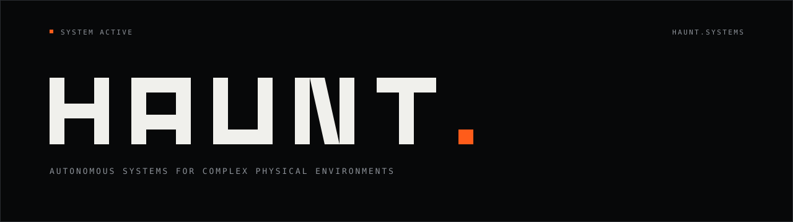

**HAUNT builds machines that perceive, track, and act in the physical world** —
perception, estimation, prediction, and control engineered as one measured loop.
Simulation first, hardware second.

[`HAUNT.SYSTEMS →`](https://haunt.systems)
